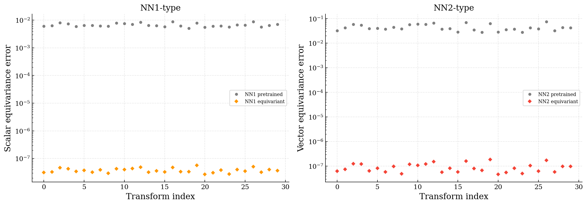
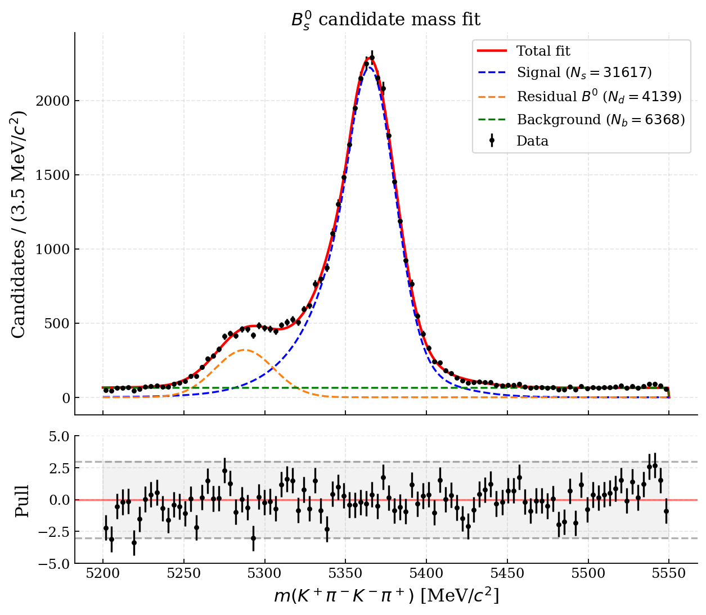

# Particle physics with data-intensive methods

Two notebook analyses connect machine learning and statistical inference with particle physics:

- [Equivariant fields](equivariant_fields.ipynb) compares pretrained neural fields with Lorentz-equivariant architectures, trains them to emulate the supplied networks, and evaluates a free-field Lagrangian under Lorentz and global SU(2) transformations.
- [Beauty-meson decays](beauty_mesons.ipynb) studies Bs → K⁺π⁻K⁻π⁺ through particle-identification cuts, alternative mass hypotheses, a boosted decision tree, an extended mass fit and sWeighted invariant-mass projections.

The notebooks contain the analysis and interpretation. `equivariant_models/` and `decay_analysis/` contain their numerical and plotting helpers.

## Results

With seed 1123, the scalar and vector architectures give mean Lorentz-equivariance errors of **3.78 × 10⁻⁸** and **9.19 × 10⁻⁸** across 30 sampled transformations. Their emulation MSEs are **4.46 × 10⁻⁵** and **1.43 × 10⁻³** on 2,000 held-out points. The architectural constraints enforce Lorentz symmetry; the internal SU(2) representations are specified as transformations of the field outputs.



The decay classifier gives **92.63% class-balanced validation accuracy**. The selected sample contains 42,124 candidates in the fitted mass range, with a fitted signal yield of **31,617 ± 317** and peak position **5364.76 ± 0.22 MeV/c²**. The Kπ projections show enhancements near the K*(892) resonance.



Fit uncertainties are statistical and conditional on the chosen model; some shape parameters reach their bounds. The classifier score is a validation diagnostic, and the threshold scan is a selection criterion. sWeighted projections assume sufficient independence between candidate mass and the projected variable within each component; they do not determine resonance fractions.

## Data and model inputs

The *High Energy Physics* materials by Matt Kenzie and Sven Krippendorf supply the pretrained network architecture, loading example and weights. `TorchMLP` follows that supplied architecture. The ROOT samples and branch descriptions are available from the [CERN course directory](https://cern.ch/mkenzie/mphil/assignment/2526/) and its [Info.md](https://cern.ch/mkenzie/mphil/assignment/2526/Info.md).

The input files are external to this repository. Place the following in `data/`, or set `PARTICLE_DATA_DIR` to an existing directory containing them:

| Notebook | Required inputs |
|---|---|
| Equivariant fields | Course-provided `weights_torch_phi.pt`, `weights_torch_W.pt` |
| Beauty-meson decays | `data.root`, `mc.root` from the CERN course directory |

The ROOT files total about 4 GB. The MC `weight` branch is used for simulation overlays; the BDT uses class-balancing weights. Saved notebook outputs and the figures can be viewed without these input files.

## Run

Python 3.13 was used with the dependencies in [requirements.txt](requirements.txt): NumPy, pandas, Matplotlib, PyTorch, scikit-learn, uproot, iminuit, numba-stats, sweights and JupyterLab.

```bash
python3 -m venv .venv
source .venv/bin/activate
python -m pip install -r requirements.txt
# Optional, when inputs are stored outside data/:
export PARTICLE_DATA_DIR="/path/to/particle-data"
python -m jupyter lab
```

Launch JupyterLab from the repository root and run either notebook from top to bottom using this environment. The theory notebook trains two small emulation networks. The decay notebook loads the necessary ROOT branches and trains one BDT configuration; it requires several GB of available RAM. Figures are written to `figures/`. Numerical results can vary slightly across library versions and hardware.

## References

- *Statistical Methods*, Lecture 24: the example underlying the sWeight calculation and plotting style.
- Pivk and Le Diberder, [sPlot: a statistical tool to unfold data distributions](https://arxiv.org/abs/physics/0402083), *Nuclear Instruments and Methods A* **555**, 356–369 (2005).
- Dembinski et al., [Custom Orthogonal Weight functions (COWs) for event classification](https://doi.org/10.1016/j.nima.2022.167270), *Nuclear Instruments and Methods A* **1040**, 167270 (2022); implemented here with the `sweights` package.
